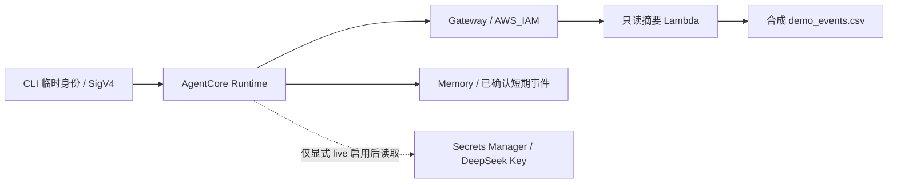

# TimeX

让四个 Agent 分别从事业、探索、生活、健康的角度讨论个人时间安排。它们先独立提出建议，再回应彼此意见，最后由协调器整理方案、让步和分歧，交给用户决定。

当前已实现两轮 LangGraph 协商、CSV / aTimeLogger 时间摘要、离线演示、OpenAI 兼容模型接入，以及同议题的单助手对照。M1 工程验收已完成，包含合成冲突/恢复情境的真实模型对照；aTimeLogger 真实摘要已在云环境完成只读验证。用户授权后的真实数据模型对照也已完成，人工质量评价仍待完成。2026-10-15 已跑通 AgentCore Runtime → Gateway → 合成 CSV，以及 Memory 确认偏好的云端 fake 链路；这组运行没有调用 DeepSeek。部署步骤和验收缺口见下文。完整计划见 [docs/POC.md](docs/POC.md)，M1 配置与验收见 [docs/M1.md](docs/M1.md)。

## 安装与运行

Python 3.11+。

```bash
python3.11 -m venv .venv
source .venv/bin/activate
python -m pip install -r requirements-live.lock -r requirements-runtime.lock
python -m pip install --no-deps --no-build-isolation -e .
python -m pip check
python -m pytest -q
python -m timex.cli --csv examples/demo_events.csv
```

也可用 `uv venv --python 3.11 .venv` 创建环境。云环境已有 `/workspace/.venvs/timex`，可运行 `source /workspace/.venvs/timex/bin/activate`，然后在 `/workspace/timex` 执行 CLI。仅需 fake CLI 演示时也可安装 `requirements-dev.lock`；完整测试包含 Runtime SDK 和 AWS SDK 的离线测试，需要上面的两份锁文件。

```bash
# 四立场协商，保存 JSON
python -m timex.cli --format json --output outputs/council.json
# 一个助手同时考虑四项利益
python -m timex.cli --baseline --output outputs/single.json
# 同议题的多 Agent / 单助手对照，保存可读报告
python -m timex.cli --compare --output outputs/comparison.md
# 结构化对照结果
python -m timex.cli --compare --format json --output outputs/comparison.json
```

默认使用 `MODEL_PROVIDER=fake` 和合成的 `examples/demo_request.json`。CLI 会保留已有输出文件；再次运行时请选择新路径。JSON 与 Markdown 是两种输出格式，上面的两条对照命令各自运行一次实验；已有 JSON 可按 [M1 文档](docs/M1.md) 转成 Markdown。

## 使用 DeepSeek 等兼容服务

推荐在 GitHub 的 `test-env` Environment 中保存 `DEEPSEEK_API_KEY`，手动运行 **DeepSeek M1 smoke** 工作流。默认 `check` 模式仅验证 Secret 是否存在及价格配置；选择 `live` 后使用 `deepseek-flash` 跑一次合成案例对照，并提供 JSON / Markdown 下载；配置步骤见 [M1 文档](docs/M1.md#github-actions-实测推荐)。

工作流已包含公开价格默认值；GitHub Variables 可选，用于覆盖价格配置。API Key 使用 Environment Secret。

普通 Python 环境也可运行：通过环境 Secret 设置 `OPENAI_API_KEY`，然后执行：

```bash
# 载入模型名、端点、输出模式及当前保守价格配置
source examples/deepseek.env.example
python -m timex.cli --live --compare --format json --output outputs/live-comparison.json
```

配置示例使用 `deepseek-flash`，对应 V4.1 Flash，依据 [DeepSeek 官方文档](https://api-docs.deepseek.com/quick_start/pricing/)（2026-10-12 核对）。示例按高峰、缓存未命中价格配置输入 $0.30、输出 $1.20／百万 Token，并关闭思考模式以配合短输出预算。显式加入 `--live` 后发起真实请求。报告保存两种方案、同一份摘要与约束、调用次数、Token、按配置价格估算的费用、时延和待填写的人工评分。

## 运行限制与结果

议会通常调用 9 次，最多 10 次；格式错误和临时网络错误合计最多重试 1 次。单助手通常调用 1 次，最多 2 次。对照中的两次运行分别应用预算，默认每次费用估算上限 $0.25，合计最多 $0.50 的软预算。调用失败或触发限制时返回 `partial` 和已验证的结果，CLI 退出码为 1；议会未完成时跳过单助手调用。

每次调用都有输入估算、输出 Token 上限、字符限制与超时。SDK 自动重试已关闭。供应商返回的 Token 用于调用后计量；缺失计量时报告 `null`，预算继续保留保守估算。配置项及估算边界见 [docs/M1.md](docs/M1.md)。

新计划分别显示默认建议、条件满足后的总上限和增加投入的触发条件；契约要求默认暂缓用0分钟表示，正文一致性仍需人工审阅。历史报告明确保留旧字段语义，详见 [计划契约](docs/M1.md#计划时长契约-v2)。

## 时间数据

`--request` 指定议题 JSON，`--csv` 用内部标准 CSV 替换其中的时间摘要。请求明确指定 7/30 天范围；`requested_minutes` 默认 180 分钟，其他议题可显式修改。若已知未来可投入的硬上限，可另填 `available_minutes`；此值同时约束默认建议、条件上限与角色建议，未知时不填。CSV 使用 `start_at,end_at,category`，时间戳带时区，按摘要指定时区的本地日期截取。

聚合器裁剪跨日记录、去除完全重复记录、拒绝重叠区间，并报告覆盖率。未知分类归入 `other`，缺口归入 `untracked`。`load_summary(..., category_map={...})` 支持分类映射。aTimeLogger 只读历史适配器使用区间并集，跨类别重叠归入 `other`，使用方式及分类变更规则见 [docs/ATIMELOGGER.md](docs/ATIMELOGGER.md)。

## 示例与验证

[离线对照报告](examples/m1-comparison-fake.md) 展示完整流程；fake 是基于摘要与同伴意见的规则模型，用来验证数据流。真实讨论效果需结合 live 报告人工评价。

pytest 覆盖 CSV、事实隔离、交叉回应、分歧契约、调用与费用预算、Token 计量、重试、超时、provider 和 CLI。CI 在 Python 3.11/3.12 上运行 fake 流程，provider 测试通过内存 HTTP 响应验证 SDK 行为。

真实输入放在 `data/private/`，运行结果放在 `outputs/`，凭证通过环境 Secrets 提供；这些本地路径已加入 Git 忽略规则。模型接收分类摘要和手动约束。下面的 AWS 演示只使用合成输入；OIDC 尚未配置，本地部署使用 AWS CLI 浏览器临时授权。

## AgentCore Runtime、Gateway 与 Memory

### 当前部署与边界

2026-10-15 在 `us-east-1` 实际验证了一个 Runtime、一个 IAM 认证 Gateway、一个摘要 Lambda 和一个 Memory。调用链如下；LangGraph 内部仍是四角色两轮和一次综合，共 9 次 fake 规则调用。



Runtime 入口为 [runtime_entrypoint.py](runtime_entrypoint.py) 和 [timex/runtime.py](timex/runtime.py)。`POST /invocations` 接收 `{"request": <DeliberationRequest>}`，缺省 `live=false`、`summary_source="request"`、`use_memory=false`。`live=true` 还要求服务端显式开启；当前部署固定 `TIMEX_ALLOW_LIVE=0`、`MODEL_PROVIDER=fake`。即使配置了 Secret ARN，fake 请求也不会读取模型 Key。

| 配置 / 行为 | 当前实现 |
| --- | --- |
| Gateway | `summary_source="gateway"`；只调用 `time-summary___get_time_summary` 一次，验证日期、时区和 7/30 天窗口后冻结摘要，报告附快照和 SHA-256 |
| 摘要目标 | Lambda 包装现有 `load_summary`，沿用跨日、覆盖率、缺口、重叠与分类语义；不是私人 aTimeLogger 账户接入 |
| Memory | `use_memory=true`；读取显式确认的短期偏好事件，保留 7 天，无自动提取策略、无后台提取执行角色 |
| 当前约束 | 结构化 `available_minutes`（包括 0）优先于记忆默认值；来源与冲突写入 `context_sources.memory`。自然语言约束冲突解析尚未实现 |
| 身份 | Memory actor 来自服务端配置，当前仅单个合成用户；尚未将经验证的调用者身份映射为独立 actor，不能声称完成多用户隔离 |
| 失败 | Gateway / Memory 获取失败分别返回 503 `gateway_unavailable` / `memory_unavailable`，不静默回退；非法请求 400，禁止的 live 请求 403 |

Gateway 使用 SDK 创建的 `AWS_IAM` 入站认证，Runtime 以执行角色 SigV4 调用；Gateway 角色仅能调用摘要 Lambda。MCP 协议采用 `2026-07-28` 无状态调用，带协议及方法头，无需旧版初始化握手。选择 Lambda 是为了复用现有统计器；外部 `atimelogger-mcp` 的托管端点、传输和认证尚未实测，不能据项目名称宣称直接兼容。[Lambda 目标](https://docs.aws.amazon.com/bedrock-agentcore/latest/devguide/gateway-add-target-lambda.html)、[MCP 调用](https://docs.aws.amazon.com/bedrock-agentcore/latest/devguide/gateway-using-mcp-call.html)、[外部 MCP 目标](https://docs.aws.amazon.com/bedrock-agentcore/latest/devguide/gateway-target-MCPservers.html)（2026-10-15 核对）。

### 本地 HTTP 入口与离线测试

在已激活的 `.venv` 中启动，默认只监听本机 8080；入口不会加载 `.env`：

```bash
MODEL_PROVIDER=fake TIMEX_ALLOW_LIVE=0 python runtime_entrypoint.py
```

在另一终端激活相同环境，检查健康状态和一次合成会议：

```bash
curl --noproxy '*' http://127.0.0.1:8080/ping
python -c 'import json; print(json.dumps({"request": json.load(open("examples/demo_request.json"))}))' \
  | curl --noproxy '*' --fail-with-body http://127.0.0.1:8080/invocations \
      -H 'Content-Type: application/json' --data-binary @-
MODEL_PROVIDER=fake TIMEX_ALLOW_LIVE=0 python -m pytest -q
```

pytest 默认阻断 socket 连接，AWS/provider 测试使用内存替身。离线通过不能替代云端验收，也不验证真实模型质量。只有显式设置 `summary_source="gateway"` 或 `use_memory=true` 才访问相应 AWS 服务。

### 构建 Linux ARM64 制品与离线预检

本地 Python 3.11 与云端语言运行时分开：云端 CodeZip 选择 Python 3.12 / Linux ARM64。不要把 macOS `.venv` 直接压缩上传；当前已验证的依赖目录和 Lambda 构建脚本共同使用以下目标路径。后续修改锁文件时应重新创建依赖目录。

```bash
uv pip install --python-version 3.12 --python-platform aarch64-manylinux_2_28 \
  --only-binary :all: --target build/runtime-dependencies-py312-arm64-glibc228 \
  -r requirements-runtime.lock
python -m timex.runtime_deploy build \
  --dependencies build/runtime-dependencies-py312-arm64-glibc228 \
  --output build/timex-runtime-py312-arm64.zip
python -m timex.runtime_deploy plan \
  --archive build/timex-runtime-py312-arm64.zip --account-id "$TIMEX_ACCOUNT_ID" \
  --profile "$TIMEX_AWS_PROFILE" --output outputs/runtime-plan.json
```

先设置下节的账号变量，再运行 `plan`；它只验证本地 ZIP、SDK 请求形状、权限模板和资源清单，不调用 AWS。`build`、`plan` 不覆盖已有输出，重复构建请选新文件名。白名单只包含运行所需源码和锁定依赖，排除 `.env`、`.aws`、私人流水、文章与报告，并检查 ELF ARM64、Python ABI、文件路径及体积。[CodeZip 运行时文档](https://docs.aws.amazon.com/bedrock-agentcore/latest/devguide/runtime-code-deploy-supported-runtimes.html)（2026-10-15 核对）；首次模板仍是预检草案，不能替代实际状态文件。

### 临时授权、首次部署与现有部署更新

当前项目使用已有 `timex-bootstrap` 浏览器临时登录，区域固定 `us-east-1`。脚本校验 STS 账号，并在进程内导出临时凭证供 boto3 使用，不创建长期 Access Key。云端命令绕过本机代理；手工 AWS CLI 命令可在当前终端先执行下列 `unset`。这会影响该终端，不修改系统代理设置。

```bash
export TIMEX_ACCOUNT_ID='你的12位AWS账号ID'
export TIMEX_AWS_PROFILE='timex-bootstrap'
unset HTTP_PROXY HTTPS_PROXY ALL_PROXY http_proxy https_proxy all_proxy
aws sts get-caller-identity --profile "$TIMEX_AWS_PROFILE" --region us-east-1
# 仅在临时凭证过期时重新走浏览器授权
aws login --profile "$TIMEX_AWS_PROFILE" --region us-east-1
```

现有 Runtime 已部署，继续开发只执行下方“更新”步骤；不要重复执行 `bootstrap` / `deploy`。首次环境参考流程如下，执行前需审阅离线计划：`bootstrap` 会创建项目执行角色、S3 制品桶和部署 IAM 用户/策略；用户不存在控制台入口时还会生成本地权限 600 的初始登录文件。`deploy` 默认只接受项目 IAM 身份；本轮单次 root 临时部署通过显式 `--allow-root-bootstrap` 放行。IAM 控制台登录故障仍待排查，这些命令不是登录修复步骤。

```bash
# 仅首次：会创建 AWS/IAM 资源
python scripts/runtime_cloud.py bootstrap --profile "$TIMEX_AWS_PROFILE" --account-id "$TIMEX_ACCOUNT_ID"
python scripts/runtime_cloud.py deploy --allow-root-bootstrap \
  --profile "$TIMEX_AWS_PROFILE" --account-id "$TIMEX_ACCOUNT_ID"
# 查询到 READY 后，再执行一次 fake 验证
python scripts/runtime_cloud.py status --profile "$TIMEX_AWS_PROFILE" --account-id "$TIMEX_ACCOUNT_ID"
python scripts/runtime_cloud.py smoke --profile "$TIMEX_AWS_PROFILE" --account-id "$TIMEX_ACCOUNT_ID"
```

首次 `deploy` 读取固定制品 `build/timex-runtime-py312-arm64.zip`。后续更新接受 `--archive`。Gateway/Memory 集成脚本当前为本项目已授权的同账号 root 临时会话编写，暂不支持用故障中的 `timex-deployer` profile 替代。状态在 `outputs/aws-runtime-state.json` 和 `outputs/aws-integrations-state.json`，含账号/区域/资源标识但不含临时凭证；换账号或丢失状态时先核对资源，不手工指向未知资源。已有同名资源需有 TimeX 管理标签才可接管。

```bash
# 1. 实际创建/更新 Gateway 与只读摘要 Lambda
python scripts/integrations_cloud.py gateway-deploy --profile "$TIMEX_AWS_PROFILE" --account-id "$TIMEX_ACCOUNT_ID"
# 更新现有 Runtime，注入 Gateway URL，继续 fake-only
python scripts/integrations_cloud.py runtime-update \
  --archive build/timex-runtime-py312-arm64.zip --profile "$TIMEX_AWS_PROFILE" --account-id "$TIMEX_ACCOUNT_ID"
python scripts/integrations_cloud.py gateway-smoke --profile "$TIMEX_AWS_PROFILE" --account-id "$TIMEX_ACCOUNT_ID"

# 2. 实际创建短期 Memory，并授予 Runtime 精确资源权限
python scripts/integrations_cloud.py memory-deploy --profile "$TIMEX_AWS_PROFILE" --account-id "$TIMEX_ACCOUNT_ID"
python scripts/integrations_cloud.py runtime-update \
  --archive build/timex-runtime-py312-arm64.zip --profile "$TIMEX_AWS_PROFILE" --account-id "$TIMEX_ACCOUNT_ID"
python scripts/integrations_cloud.py memory-smoke --profile "$TIMEX_AWS_PROFILE" --account-id "$TIMEX_ACCOUNT_ID"
```

每次修改运行源码后先重新构建；更新脚本会拒绝与当前源码不一致的 ZIP。Gateway 测试是一次实际云端会议（9 次 fake 调用），另验证签名工具列表和未签名请求被拒绝。Memory 测试是 **5 次独立 Runtime 会议 + 3 次偏好操作**：无偏好 → 确认 30 分钟 → 当前请求覆盖为 60 分钟 → 更正为 45 分钟 → 删除后恢复。每场会议使用同一摘要快照；正常完成后删除本次合成偏好。中途失败可能留下测试事件，应检查后再重试。测试使用专用合成 actor/stream，不能在存有真实用户偏好的流上运行。

偏好操作通过同一 `/invocations` 入口，必须显式 `confirmed=true`；确认/更正还需 `preference={"text":"合成用户确认的偏好", "maximum_minutes":30}`。操作为 `confirm_preference`、`correct_preference`、`delete_preference`，不运行议会或模型。旧偏好存在时需更正，不能再次确认为新值；更正和删除会删除旧确认事件，防止旧值再次生效。调用者不能在请求中指定 actor 或 Memory ID。

### DeepSeek Key 存储：准备凭证，不开启模型

用户授权后可将本地权限 600 的 `.env` 中 `OPENAI_API_KEY`（也接受同值 `DEEPSEEK_API_KEY`）写入 `us-east-1` 的项目 Secret `timex/deepseek`。上传脚本只解析选中的字段，不执行 dotenv 文本；SecretString 通过 SDK 在内存中发送，不出现在命令参数、制品和输出中。采用 AWS 托管 `aws/secretsmanager` 密钥，执行角色只获该 Secret ARN 的 `GetSecretValue` 权限。[创建 Secret](https://docs.aws.amazon.com/secretsmanager/latest/apireference/API_CreateSecret.html)、[访问策略](https://docs.aws.amazon.com/secretsmanager/latest/userguide/auth-and-access_iam-policies.html)（2026-10-15 核对）。

```bash
python scripts/integrations_cloud.py secret-upload --env-file .env \
  --profile "$TIMEX_AWS_PROFILE" --account-id "$TIMEX_ACCOUNT_ID"
# 读取本地状态中的 ARN，更新 Runtime；不上传 .env，不开启 live
python scripts/integrations_cloud.py runtime-update \
  --archive build/timex-runtime-py312-arm64.zip --profile "$TIMEX_AWS_PROFILE" --account-id "$TIMEX_ACCOUNT_ID"
```

已有项目 Secret 时会写入新版本，因此仅在首次配置或明确轮换时上传；上传后执行一次 Runtime 更新，避免复用进程内缓存的旧 Key。Runtime 环境只存 `TIMEX_DEEPSEEK_SECRET_ARN`，日常保持 `MODEL_PROVIDER=fake`、`TIMEX_ALLOW_LIVE=0`。2026-10-15 的上传只验证了 Secrets Manager 存取一致性；2026-10-16 经单独授权，已通过下节实际模型请求验证执行角色取 Key 与 DeepSeek 外部网络路径。没有启用 AgentCore Identity API key provider。后续 live 仍需明确开启服务端、配置模型/价格/预算并在请求显式指定 `live=true`。

### 已授权的云端 DeepSeek 小额对照

只有明确需要真实模型演示时运行以下命令。`plan` 完全离线；`run --live` 使用现有 Runtime、Gateway、Memory 和 Secret，不读取本地 `.env`。场景为 [公开合成请求](examples/agentcore_live_request.json)：用户确认有自主时段和兴趣价值，历史记录仍经 Gateway 读取，不从记录缺口推断空闲。

```bash
python scripts/agentcore_live_demo.py plan --output outputs/agentcore-live-demo-2026-10-16
python scripts/agentcore_live_demo.py run --live \
  --profile "$TIMEX_AWS_PROFILE" --account-id "$TIMEX_ACCOUNT_ID" \
  --output outputs/agentcore-live-demo-2026-10-16
```

固定三次独立会议：无偏好 → Memory 默认上限 30 分钟 → 当前请求明确上限 60 分钟。每场正常 9 次、最多 10 次 DeepSeek 调用，单场软预算 $0.05，整组最多 30 次、合计软预算 $0.15；按核对的高峰缓存未命中价格保守估算，不是账单或硬封顶。另有一次不调用模型的偏好确认。某场返回 partial 或触发限制后停止后续付费阶段，不自动重跑整组。

运行期间短暂开启服务端 live；`finally` 恢复原始 fake 环境，并让 DEFAULT 指向恢复配置后的新版本，删除本轮带唯一标记的合成偏好，每个 Runtime 会话都请求停止。恢复失败会写入报告并返回非零状态；目录中的 `restore-request.json` 保留无明文 Key 的原始配置，供检查恢复。已有偏好的合成流会被拒绝，避免覆盖其他数据；已启动目录不能再次执行，避免意外重复付费。其他工作树可用 `--state-dir` 指向已有本地部署状态目录。

报告保留在指定目录：`plan.json`、`summary.json`、逐场输入/完整结果及可读 HTML。相同事实快照不意味着模型必定改变立场；用户反馈、语义审阅与工程检查分开记录。AWS 服务费用另计，文章和私人输入不进入此流程。

2026-10-16 实际运行结果（合成输入，`deepseek-flash`，无人工改写或强制预定结论）：

| 场景 | 结果 | 角色建议 / 综合 | 模型调用与估算费用 |
| --- | --- | --- | --- |
| Gateway 摘要，无记忆偏好 | complete | 首轮事业/探索/生活/健康为 45/90/60/45；第二轮均为45，综合默认45、条件上限90，保留分块与追加条件的分歧 | 9 次，$0.0122793 |
| 新会话读取 Memory 默认30分钟 | partial | 首轮四角色均30；第二轮健康角色未通过输出契约，无综合方案 | 9 次，$0.0112800，包含失败及修复调用 |
| 当前请求覆盖为60分钟 | 未执行 | 第二场失败后按计划中止，不能宣称该场真实模型验收通过；此前 fake 覆盖测试仍独立保留 | 0 次 |

第二场先出现 `json_invalid`，消耗全局一次修复额度；后续健康角色输出 `extra_forbidden`，因此如实返回 partial，没有放宽校验或补写发言。两场共18次模型调用，按配置价估算 $0.0235593，AWS费用未测量；测试会话停止、合成偏好删除，服务已恢复 v6 的 fake 配置。原件在 `outputs/agentcore-live-demo-2026-10-16/`，不是公开仓库内容。

这组输入明确了未来自主时段、当前精力和非功利目标，为非零建议提供依据；它与此前本地旧案例不是同一输入，不能直接证明提示词质量提升。仍观察到旧条件被说成新让步，以及记忆默认上限被模型误读为实际可用时间的风险；结构通过不代表语义正确。

### 权限、证据与资源保留

| 身份 / 资源 | 已部署的职责与边界 |
| --- | --- |
| 部署者 / Runtime 调用者 | 当前是已有 root 临时授权，权限很宽；尚未完成非 root 部署与调用者最小权限验收。首次项目部署策略含限定执行角色的 `iam:PassRole`，尚无 Gateway/Memory 部署者联调证据 |
| Runtime 执行角色 | 读取项目 S3 制品、写自己的运行日志、调用一个 Gateway、读写一个 Memory 的事件；另可读取一个 DeepSeek Secret。没有 `bedrock:InvokeModel` 权限 |
| Gateway 执行角色 | 仅 `lambda:InvokeFunction` 到摘要函数，信任限定本账号的项目 Gateway |
| 摘要 Lambda 角色 | 仅自己的日志权限；数据随包携带，不访问私人账户，不调用模型 |
| Memory | 无长期提取策略/提取角色，应用仅写明确确认的 USER 事件；actor 名称本身不构成访问控制 |

实测原件保留在忽略提交的 `outputs/`，不会随 README 上传：

| 本地文件 | 内容 |
| --- | --- |
| `aws-integrations-deployment-report.json` | Gateway / Memory fake 验收时的部署配置、范围和待验证边界 |
| `aws-runtime-fake-smoke.json`、`aws-runtime-fake-result.json` | Runtime 状态、请求/会话标识、两轮完整 fake 对话 |
| `aws-gateway-smoke.json`、`aws-gateway-council.json` | 单次取数快照、IAM 未签名 401 拒绝和完整对话 |
| `aws-memory-smoke.json`、`aws-memory-*-council.json` | 五阶段的来源事件 ID、前后建议、覆盖/更正/删除证据 |
| `aws-deepseek-secret-upload.json`、`aws-deepseek-runtime-check.json` | Secret ARN/版本、存取一致性和后续 Runtime 配置核验；不含 Key，不代表执行角色取值或 DeepSeek 实测 |
| `aws-runtime-state.json`、`aws-integrations-state.json` | 当前资源与版本；上面历史报告不替代最新状态 |
| `aws-*-permissions.json`、`aws-runtime-*-policy.json` | 实际生成的角色权限，供本地审阅 |

所有 fake 测试的模型费用为 0；Runtime、Gateway、Lambda、Memory、Secrets Manager、S3 和日志仍按 AWS 服务计费，当前未取得实际费用或失败尝试账单，不以模型估算当作云服务总费用。每次云端测试会在 `finally` 请求停止 Runtime 会话；服务配置空闲 60 秒、最长 600 秒。资源仍保留供开发，合成 Memory 偏好已在成功测试后清理。日志目前只核验过日志组元数据，未导出日志正文、未修改保留期；不要声称日志费用/清理验收完成。

完整停用时先停止调用并移除 Runtime/Gateway target，再删除 Gateway、摘要 Lambda、Memory，清理项目 S3 制品及按需保留的日志，给 Secret 安排恢复窗口内删除，最后移除项目角色及其策略。当前没有执行资源销毁，也没有自动清理命令；只操作状态文件记录且核对标签的项目资源。

### 相关 issue 尚缺的验收

以下按 2026-10-15 的 issue 描述与本地证据核对，不改 GitHub 勾选状态；代码测试、云端 fake、真实模型质量和用户体验分别验收。

| Issue | 已有工程证据 | 尚缺 / 后续处理 |
| --- | --- | --- |
| [#8 协商体验](https://github.com/ratio-dd/timex/issues/8) | 角色与分阶段提示词、保留两轮、边界测试和已有实测反馈 | 旧条件被写成新让步、职业产出成为探索门槛、总投入被误读为连续投入仍需语义回归；用户体验反馈和 demo 定稿待完成。工程源码按用户本次指令推送，文章发布另行决定 |
| [#9 Runtime](https://github.com/ratio-dd/timex/issues/9) | 薄 HTTP 入口、ARM64 CodeZip、云端 fake 与一次完整 DeepSeek 会议、执行角色取 Secret、会话停止和恢复 fake | PR/配置审阅；AWS 费用、日志保留与用户体验验收 |
| [#11 Gateway](https://github.com/ratio-dd/timex/issues/11) | Lambda 目标实调、一次冻结摘要、统计语义复用、未签名401；摘要已进入完整云端 DeepSeek 会议 | 外部 atimelogger-mcp 直接兼容性仍未实测；用户可读体验验收与云服务费用。私人账户接入不是当前合成 demo 的必要项 |
| [#13 Memory](https://github.com/ratio-dd/timex/issues/13) | 云端短期事件五阶段 fake 对照；实际 DeepSeek 新会话读到偏好并影响首轮，但该场最终 partial | 完整真实模型协商及当前约束覆盖；偏好上限与可用时间的语义区分；可信调用者到 actor 的绑定。长期提取若采用需另行核对与授权 |
| [#12 IAM 与凭证](https://github.com/ratio-dd/timex/issues/12) | 执行角色权限、Gateway 拒绝证据、Secrets Manager 与实际模型调用取 Key 路径 | 非 root 登录继续暂缓；部署/调用者最小权限、Secret 拒绝/失效、Memory 身份绑定及配置审阅仍待验证 |
| [#10 日志与计量](https://github.com/ratio-dd/timex/issues/10) | 请求/会话 ID、应用阶段/调用/耗时记录、已有失败原因 | CloudWatch 与应用记录关联、主要耗时解释、保留/费用/清理证据；未启用完整自动模型 trace |
| [#7 总览](https://github.com/ratio-dd/timex/issues/7)、[#14 文章](https://github.com/ratio-dd/timex/issues/14) | 本 README 和合成证据可供另一个 thread 引用 | 用户体验、文章/截图及技术隐私 review 仍独立验收；文章及其本地提交不包含在工程分支中，仓库可见性不变 |

### 整理供文章引用的本地资料

在已有上述合成实测报告后，可离线收集一个独立资料目录：

```bash
python scripts/collect_article_materials.py --output outputs/article-materials-2026-10-16
```

打开目录中的 `index.html`：内含历史本地 DeepSeek 对照、AWS 完整 fake 对话、Memory 前后对照、JSON 证据、关键源码快照、失败与限制、官方来源，以及原件 SHA-256 清单。收集器只读取显式白名单；AWS 议会报告必须为 fake 且匹配演示议题，两份历史 live 报告则必须通过完整请求与公开合成示例的一致性校验。替换账号和项目资源标识，保留请求/会话/事件 ID 以便关联。不收集 `.env`、临时凭证、初始 IAM 密码、私人数据或文章正文。输出目录已存在时拒绝覆盖；代码或证据变更后请选择新目录刷新。
