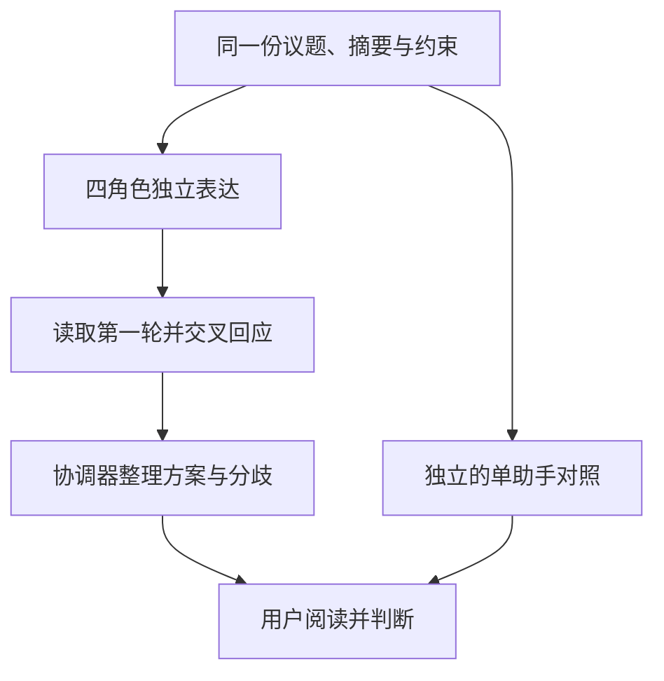
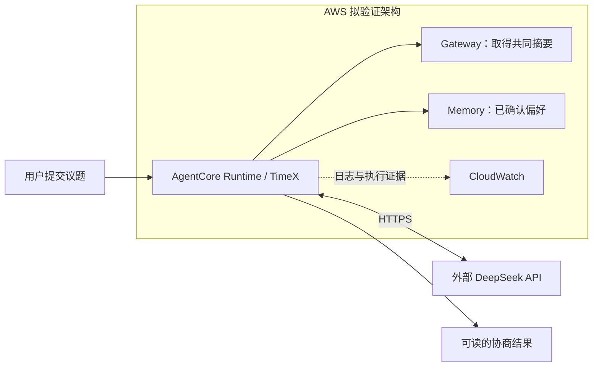

# 把“内心的四种声音”部署到 AWS：基于 AgentCore 与 DeepSeek 的 TimeX 多 Agent 实践

> 2026-10-15 编辑稿。LangGraph 与 DeepSeek 的协商实测已完成；AgentCore Runtime、Gateway、Memory 尚未部署验证。标题表达整篇计划，不能据此认定已在 AWS 跑通。今晚若发布而云端验证仍未完成，应将标题改为《让“内心的四种声音”开会：TimeX 多 Agent 实验与 AgentCore 部署设计》，保留下面所有状态说明。本文未发布。

## 我想让四个“自己”开一次会

晚上有一点时间，我想继续做一个技术实验。但另一个声音提醒我：明天还有工作。还有一个声音说，好不容易空下来，为什么不能玩一会儿？最后一个声音只想早点休息。

TimeX 想探索的，就是这种很普通的内在讨论。这里的四个 Agent 分别代表事业、探索、生活和健康。它们面对同一份时间摘要与议题，先独立表达，再读取彼此的观点，最后把可以接受的方案和仍然存在的分歧交给用户。

这不是一个替人决定日程的系统。它最初是一个出于好奇和娱乐的 POC：如果不同利益有机会充分说话，我会不会更容易理解自己的选择？

## 第一次看完整讨论，我觉得它们像在附和

工程很快有了不少进展：真实模型能够调用，结果可以保存，程序会在失败时停止。但这些并没有回答最初的问题——讨论到底有没有意思？

用户读完一份实际记录后的反馈是：“目前像四个人附和，文章重点写探索过程与教训。”随后补充了一个更具体的判断：可能是四个人的人设和 soul 没有写好，导致它们停留在字面关注点，而没有从不同角度真正分析。

检查现有角色配置能看到，每个角色目前主要是一句利益描述。例如，事业关注工作、收入和未来选择，健康关注睡眠、恢复和可持续性。这说明角色边界还很薄，但不能由此直接证明重复回应一定由人设造成。议题本身冲突不足、所有角色受到相似约束、模型的表达习惯，也都可能有影响。

因此，这篇文章保留失败的体验，不把“跑完九次调用”写成“出现了高质量协商”。

## LangGraph 如何组织会议

一次议会有三个阶段：四个角色分别给出初始立场；四个角色读取所有第一轮观点后回应；协调器整理结果。通常是九次模型调用，额外的单助手对照独立读取相同事实。

第二轮不是实时插话，也不是无限争辩。程序要求角色指出回应对象、解释改变或坚持的理由，并允许留下分歧。模型目前通过 OpenAI 兼容接口调用外部 DeepSeek。

时间摘要是共同背景，不能直接代表未来空闲。用户希望投入的分钟数、已经确认能投入的上限，以及模型提出的条件上限，需要区别对待。最终的决定仍属于用户。

## 已有实测：180分钟的愿望，60分钟的现实

以下是一次真实模型运行，情境与时间记录完全合成。它不是用户的真实日程，也不是提前编排的剧本。完整发言见[协商实录](demo/conflict-transcript.md)。

议题是：本周想花180分钟开发一个Agent实验，但只有周三晚60分钟可自主安排；不能挪用固定活动、睡眠或必要工作。

| 角色 | 第一轮建议 | 第二轮建议 |
|---|---:|---:|
| 事业 | 60分钟 | 60分钟 |
| 探索 | 60分钟 | 60分钟 |
| 生活 | 60分钟 | 60分钟 |
| 健康 | 30分钟 | 45分钟 |

健康角色第二轮写道：

> 坚持健康优先，但接受在周三晚60分钟自主窗口内把Agent实验上限从30分钟放宽到45分钟，前提是先确认自身状态良好；仍不支持本周投入180分钟。

生活角色没有接受把30分钟设为普遍上限，回应中保留了这样一句话：

> 我接受疲劳高时降到30分钟作为条件，但不把30分钟设为普遍上限。

这一次有了可见的让步，也留下了45与60分钟的分歧。但45分钟不是经过验证的最优解。让步可能有道理，也可能只是模型选择了一个折中数字，不能因为出现了变化就宣布协商成功。

同输入的单助手建议在60分钟内做最小实验，时间盒结束即停。该次对照合计11次调用，耗时38.048秒，输入19,546、输出4,258 Token，按当时配置单价估算约0.01097美元。费用包含单助手首次遗漏约束后的重试，不是账单，也不是全部开发成本。

另一份真实数据运行中，四个角色两轮都保留了90分钟，主要增加或重复条件。私人输入和原文不放进公开文章。这也解释了为什么不能只挑“30变45”的案例当成产品效果。

## 角色的 soul 应该改变什么？

用户提出的方向不是让四个角色更爱争吵，而是让它们有不同的判断方式。例如：事业考虑这项实验会留下什么可复用成果；探索考虑它能回答什么未知问题；生活考虑这段时间是否还属于用户自由选择；健康考虑当天的恢复成本，而不只盯着睡眠总分钟数。

角色也要能说明什么证据会让自己改变。事业可以支持没有即时收益、但能增加未来选择的探索；健康不必永远主张零投入；生活可以支持用户真心想做的项目；探索也可以反对没有学习目标的重复折腾。

这目前是一组待审阅的设计假设，[soul草案](DEMO.md#角色-soul-草案尚未用于模型运行)尚未写入运行代码，也没有新增付费验证。现有记录中的附和不会被这份设计事后改写。

## 下一幕：把这场会议放到 AgentCore Runtime

以下是部署设计，尚无本项目的AWS实测结果。

我们计划把同一个LangGraph程序放进一个AgentCore Runtime，模型继续调用外部DeepSeek。四个逻辑角色共用一个程序，不需要四个独立Runtime。AgentCore支持使用外部模型与不同Agent框架；账户是否有目标区域权限、出站网络和凭证获取是否正常，还需要实际验证。[官方说明](https://aws.amazon.com/bedrock/agentcore/faqs/)

文章会用实际部署说明Runtime入口、依赖打包与调用方式，保留部署日志、运行结果和清理记录。没有完成这一步之前，不能把架构图称为运行架构，也不能填入推测的AWS耗时和费用。

## IAM不是一句“给权限”

对这个demo，至少有三种职责需要分清：部署者创建资源；调用者发起一次会议；Runtime执行角色获取运行需要的资源。Gateway目标访问和Memory访问还各有相应的授权关系。DeepSeek API Key则是外部服务凭证，不是AWS IAM权限。

实际配置要根据选定部署路径审阅。不能因为示例提供宽泛策略，就认为所有权限都适合TimeX；也不能把session或actor标识当成访问控制。我们计划用一张小权限表解释每条路径，而不是向读者堆一份未经验证的IAM JSON。[Runtime权限说明](https://docs.aws.amazon.com/bedrock-agentcore/latest/devguide/runtime-permissions.html)

凭证存储可评估AgentCore Identity API key provider等受支持方案，但尚未完成TimeX联调。文章会明确最终使用哪个方案，不会把“讨论过Identity”写成“已经使用Identity”。[凭证提供者说明](https://docs.aws.amazon.com/bedrock-agentcore/latest/devguide/resource-providers.html)

## Gateway：先取得事实，再讨论

Gateway这一段要回答的是：四个角色究竟在基于什么事实说话？计划只接入一个只读时间摘要工具，在讨论前读取一次，随后把同一份快照交给所有角色。

AWS提供不同的Gateway目标类型，但现有aTimeLogger MCP的传输、认证和版本是否匹配，仍需核对。必要时使用已有摘要适配器的最小包装，保留原统计语义。[支持的目标类型](https://docs.aws.amazon.com/bedrock-agentcore/latest/devguide/gateway-supported-targets.html)

公开demo优先使用合成数据，通过真正的AWS Gateway取得摘要。这可以验证AWS工具调用链，但不能宣称完成了真实账户接入。

## Memory：下一次讨论，记住的是谁的意见？

计划中的连续demo是：用户确认“工作日晚间最多学习30分钟”，下一次会议从Memory取得这项偏好，再开始讨论。模型提出的建议不能自动变成用户已经认可的长期偏好。

AgentCore区分短期事件与长期记忆；自动提取可能是异步过程，还可能涉及额外模型处理、权限与费用。这需要结合当前账户验证，不能因为协商模型用DeepSeek，就假设记忆服务也不涉及其他模型依赖。[Memory入门](https://docs.aws.amazon.com/bedrock-agentcore/latest/devguide/memory-get-started.html)

实测时我们会展示确认、写入、新会话检索和引用的证据。如需等待提取，就如实呈现等待；如果账户只支持另一种路径，也会说明差别，不把本地预写的偏好冒充云端记忆。

## 我们准备如何判断这次实验

TimeX目前最明确的收获，是把不同利益摆到了同一张桌子上；最明显的问题，是角色很容易礼貌地重复彼此。

接下来要观察的是：更清晰的角色价值观能否改变分析角度？工具提供的事实有没有被正确使用？记忆是否帮助用户，还是让过去的一次选择固化成了规则？这些问题不能靠一次成功调用或测试通过率回答。

文章最终需要补齐的AWS证据包括：Runtime实际运行、Gateway实际取数、Memory跨会话引用、对应IAM配置与review、DeepSeek和AWS分别计量的费用，以及清理状态。目前这些项仍待验证。已有M1结果和用户反馈则可直接分享，不必等到所有云端集成完成才承认这次实验有局限。

---

技术资料核对日期：2026-10-15；实现与付费实测前再次核对版本、区域及价格。本文的协商片段来自2026-10-13已有运行，不涉及本轮新增模型调用。代码公开不代表私人时间记录也可公开。
